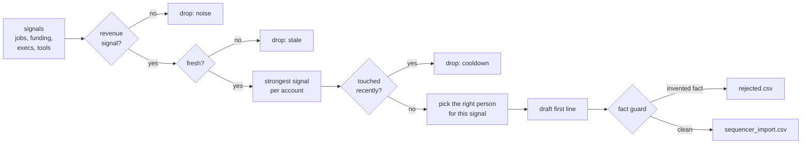

# signal-outbound

Turns buying signals into outreach — and refuses to send any line containing a fact it can't back up.

Runs on your laptop. No API keys, no network.


---

## The problem

Cold outbound is mostly dead. Outbound triggered by something that just happened at the account — a funding round, a new CRO, a RevOps hire — still works.

But the moment you let AI write those emails at volume, it starts "improving" the facts. The $42M round becomes $50M. An investor who sounds right appears out of nowhere. The company quietly grows to 400 people. One confidently wrong sentence and the prospect knows nobody read their news — and that account is burned.

So this pipeline has one rule it will not break: **every number and every name in an outgoing line must exist in the source signal.** Anything else is rejected before it reaches the sequencer.

## What it does



## The fact guard

`src/signal_outbound/guard.py` pulls every **number** and every **proper name** out of a drafted line and checks each against the evidence — the signal text plus the contact's own record. One unsupported fact and the line is rejected, with the reason.

It also rejects lines that mention nothing from the signal at all. "Hope you're well, quick question about your stack" could be sent to anyone, which means it isn't signal-based outreach.

The demo includes a deliberately careless writer — clearly labelled as a simulation — that does what a sloppy AI writer does: rounds numbers up, name-drops an investor, invents a headcount. Here's the guard catching it:

```
"Congrats on the $26M Series C, Nadia — ..."
  ✗ number '$26M' is not in the evidence; name 'Series C' is not in the evidence

"Dana, congrats on the Chief Revenue Officer role, and with Sequoia now on the cap table — ..."
  ✗ name 'Sequoia' is not in the evidence

"Priya, noticed Northwind Signals is hiring a Revenue Operations Manager (and at 400+ people now) — ..."
  ✗ number '400' is not in the evidence
```

The real source said **$18M Series A**, named **no** investor, and gave **no** headcount.

**The guard's first catch was my own template.** The line for new executives originally said revenue leaders rebuild the pipeline "in their first 90 days". The guard rejected it — 90 isn't in the evidence. It was right: it can't tell a sender's rule of thumb from a claim about the prospect, and it shouldn't have to. The house copy now contains no figures.

## Run it

```bash
pip install -r requirements.txt
make test        # 19 tests, offline
make demo        # the real writer: 14 signals in, 8 clean lines out
make naive       # the simulated careless writer, and the guard catching it
make again       # run a second time the same day — cooldown means 0 go out
```

`make demo` writes two files:

- `out/sequencer_import.csv` — columns Smartlead, Instantly and Apollo accept on CSV import. `first_line` maps to a custom variable like `{{first_line}}` in the email template.
- `out/rejected.csv` — every line the guard stopped, with the reason, for a human to review.

## The funnel

Every drop is counted and explained, because "why didn't this account get an email?" deserves an answer:

```
signals in                          14
- noise (not a revenue signal)       3    frontend engineer, new CFO, data engineer
- stale (older than 30 days)         1    a funding round from July
- weaker signal, same account        1    Northwind: RevOps hire beats funding
- on cooldown                        0
- no matching contact                1    Quillmark: no sales leader on file
= drafted                            8
- REJECTED by fact guard             0
= ready for the sequencer            8
```

## Decisions worth explaining

**Signal strength decays with age.** A RevOps hire starts at 85, a new CRO at 90, a funding round at 75 — and each drops linearly to zero over 30 days. A three-week-old funding round is weaker than yesterday's job post.

**One signal per account per run.** When Northwind shows both a funding round and a RevOps hire, only the stronger one is used. Two emails referencing two different events in one week reads like a bot.

**Cooldown is per account, not per contact.** Emailing the VP Sales on Monday and the RevOps lead on Wednesday at the same company is how you get marked as spam by their IT team.

**The persona depends on the signal.** A RevOps hire goes to the head of revenue operations; a funding round goes to the CRO or founder; a CRM migration goes to sales ops.

**Role titles are parsed from sentence structure, not keyword search.** A keyword search for "RevOps" matched the *company name* "Cadence RevOps" and produced *"is hiring a RevOps"*. The parser now reads `hiring a <Title> in/to/for`. There's a test named for it.

**Output is a CSV, not an API push.** Every sequencer imports CSV, it needs no credentials, and it leaves a human checkpoint between a machine's decision and an email arriving in a stranger's inbox. That checkpoint is a feature.

## Layout

```
data/signals.json          14 fictional signals (see note below)
data/contacts.json         fictional contacts at those accounts
src/signal_outbound/
  signals.py               load, classify, strength with decay
  guard.py                 the fact guard
  writers.py               TemplateWriter (real) and NaiveWriter (simulated)
  pipeline.py              the funnel, cooldown, persona matching, export
  cli.py
tests/                     19 tests, no network
```

## Notes and limits

- **All companies, people and events in `data/` are fictional**, written for this repo so the demo is deterministic and runs offline. They are not real businesses or announcements.
- **Signal collection is out of scope.** In production the signals come from job-board scrapers, a funding data provider, LinkedIn exec-change alerts or tech-detection tools. This repo starts from the point where those signals exist as text.
- **The guard is conservative on purpose.** It will occasionally reject a harmless line — a capitalised word it doesn't recognise. A false rejection costs a human thirty seconds in `rejected.csv`. A false acceptance costs an account.
- **An LLM writer plugs in** with the same `draft(signal, type, contact)` shape as `TemplateWriter`, and its output goes through the same guard unchanged. That's the point of keeping the check separate from the writer.

## Related

Part of a set: [icp-scorer](https://github.com/affanee/icp-scorer) decides which accounts are worth pursuing, [lead-router](https://github.com/affanee/lead-router) handles inbound, and this handles signal-triggered outbound.

## Licence

MIT.
